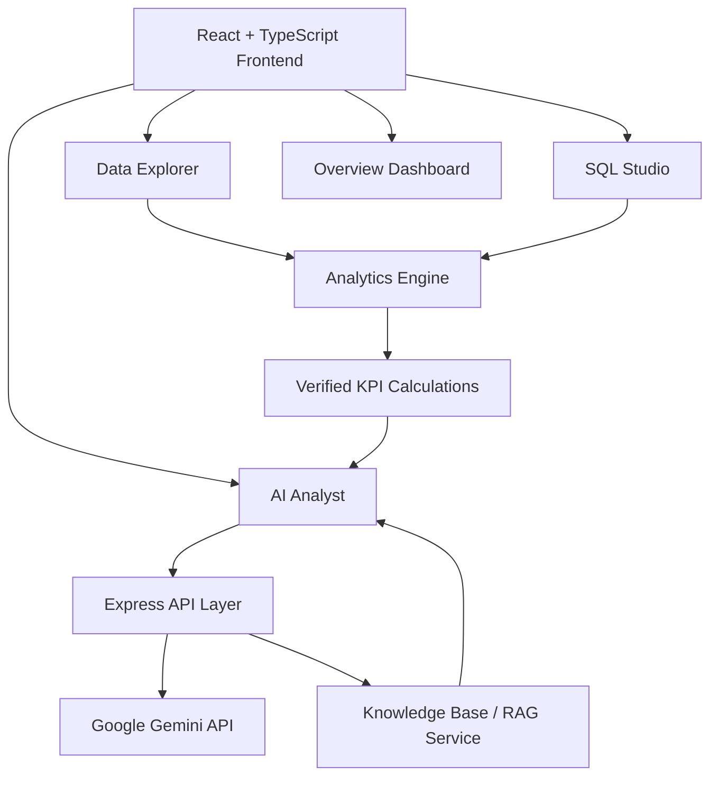

# DataHarvest

DataHarvest is an AI-powered analytics workspace built for turning raw business data into actionable insight. It combines a modern React interface, deterministic KPI calculations, SQL analysis, and AI-assisted conversations to help users explore datasets, ask questions in plain English, and validate results with transparent reasoning.

Built for teams that need fast analysis without sacrificing trust, DataHarvest focuses on grounded metrics, read-only data workflows, and clear explanations behind every recommendation.

## Why DataHarvest?

- Natural-language analytics with dataset-aware AI responses
- Reliable, formula-driven KPI calculations instead of guesswork
- CSV/XLSX ingestion with automated quality checks
- SQL studio for read-only exploration and reporting
- Knowledge-base grounding for policy and operational context
- Lightweight full-stack app with no heavy backend setup required

## Core Features

### AI Analyst
- Ask questions in natural language about your dataset
- Receive answers grounded in the active dataset and calculated metrics
- Get KPI cards, suggested charts, and SQL guidance when applicable
- Works with a live Gemini model when configured and falls back to a deterministic local engine when not

### Data Quality & Analytics Engine
- Upload CSV or Excel files
- Detect missing values, duplicates, and data quality issues
- Compute revenue, profit, margin, and trend metrics from raw records
- Keep calculations transparent and reproducible

### SQL Studio
- Run read-only SQL queries against uploaded and in-memory datasets
- Generate SQL from natural language prompts
- Prevent destructive operations with guardrails
- Support schema inspection and warehouse-style sandbox workflows

### Knowledge Base
- Search internal guidance, business rules, and reference content
- Retrieve evidence-backed passages and match them to user questions
- Use relevant policy information to improve analysis quality

### Data Workflows
- Explore data in tabular views
- Review chart summaries and KPI snapshots
- Track history and session context for reporting and analysis reuse

## Architecture Overview



## Tech Stack

- Frontend: React 19, TypeScript, Vite, Tailwind CSS
- Backend: Node.js, Express, TypeScript
- AI: Google Gemini SDK
- Data Processing: Papa Parse, XLSX, AlaSQL
- Visualization: Plotly.js
- Environment: dotenv

## Project Structure

```text
Data-Harvest/
├── src/
│   ├── components/
│   ├── services/
│   ├── types/
│   ├── App.tsx
│   ├── main.tsx
│   ├── sampleData.ts
│   └── index.css
├── sample_data/
│   └── sales_demo.csv
├── index.html
├── metadata.json
├── package.json
├── server.ts
├── tsconfig.json
├── vite.config.ts
├── bun.lock
├── README.md
└── .env.example
```

## Getting Started

### Prerequisites

- Node.js 18+
- npm or Bun

### 1. Install dependencies

```bash
npm install
```

or

```bash
bun install
```

### 2. Configure environment variables

Create a `.env` file in the project root:

```env
GEMINI_API_KEY=your_gemini_api_key
PORT=3000

SNOWFLAKE_ACCOUNT=
SNOWFLAKE_USER=
SNOWFLAKE_PASSWORD=
SNOWFLAKE_WAREHOUSE=COMPUTE_WH
SNOWFLAKE_DATABASE=DATAHARVEST_ANALYTICS
SNOWFLAKE_SCHEMA=PUBLIC
```

Note: If `GEMINI_API_KEY` is not set, the app still works in a deterministic offline mode using local analytics logic.

### 3. Run the app

```bash
npm run dev
```

The application will be available at:

```text
http://localhost:3000
```

### 4. Production build

```bash
npm run build
npm start
```

## Available Scripts

```json
{
  "scripts": {
    "dev": "tsx server.ts",
    "build": "vite build",
    "start": "tsx server.ts",
    "preview": "vite preview",
    "clean": "rm -rf dist server.js",
    "lint": "tsc --noEmit"
  }
}
```

## Security & Guardrails

- Read-only SQL validation to block destructive statements
- Server-side API handling prevents exposing keys in client code
- KPI and business logic are calculated using local deterministic mechanisms
- AI outputs are designed to be explainable and grounded in dataset facts

## Use Cases

- Sales and revenue analysis
- Product performance reporting
- Data quality auditing
- BI workflow prototyping
- Internal analytics exploration for non-technical teams

## Contributing

Contributions are welcome. If you want to improve the product, extend the analytics engine, or add new data workflows:

1. Fork the repository
2. Create a feature branch
3. Make your improvements
4. Submit a pull request with a clear description

## License

This project is currently distributed under the repository's default license terms. Review the repository license file before production deployment or redistribution.

## Contact

For questions, ideas, or collaboration, connect with the project maintainer via the GitHub repository.

---

Built to help teams move from raw data to clear decisions with confidence.
