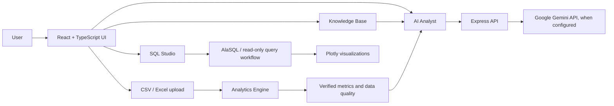

<div align="center">

# DataHarvest

### Turn data into decisions.

[](https://www.typescriptlang.org/)
[](https://react.dev/)
[](https://vite.dev/)
[](https://expressjs.com/)
[](LICENSE)

<br />

<a href="https://readme-typing-svg.demolab.com?font=Inter&weight=600&size=20&duration=2800&pause=900&color=2E7D5B&center=true&vCenter=true&width=700&lines=Explore+your+data+with+confidence;Ask+questions+in+plain+language;From+raw+files+to+clear+insights;Analyze.+Visualize.+Decide.">
  
</a>

**A full-stack analytics workspace for exploring datasets, checking data quality, visualizing KPIs, and asking data questions with AI assistance.**

[Explore the repository](https://github.com/saravanavel07/Data-Harvest) · [Report an issue](https://github.com/saravanavel07/Data-Harvest/issues)

</div>

---

## About

DataHarvest helps turn business data into useful, understandable analysis. Import CSV or Excel files, inspect records, review calculated metrics, explore charts, and use the AI Analyst or SQL tools to investigate your data. When an AI API key is unavailable, the application can still provide deterministic, locally computed analytical responses.

The interface includes a subtle particle-network background and uses Motion-powered transitions to add movement to the app experience. The animated heading above adds a live typing effect to this README when viewed on GitHub (it loads from an external SVG service).

## Features

- **Overview dashboard** — review dataset summaries and key performance indicators.
- **Data upload and exploration** — load CSV/XLSX data and inspect it in a tabular view.
- **Analytics and data quality** — calculate revenue, cost, profit, margin, trends, missing-value rates, duplicates, and quality scores.
- **AI Analyst** — ask natural-language questions with dataset context, calculated metrics, and relevant knowledge-base evidence.
- **Charts and visualizations** — explore category and time-series results with Plotly.
- **SQL Studio** — generate, validate, and run read-only analytical queries against the active dataset; includes Snowflake-oriented workflows and a demo sandbox.
- **Knowledge Base** — retrieve relevant reference material to ground answers.
- **Query history and settings** — revisit queries and review AI usage statistics.
- **Demo-ready experience** — a sample sales dataset is loaded to help explore the app.

## Application components

| Area | Components / services | Purpose |
| --- | --- | --- |
| Navigation and layout | `Sidebar`, `TopNav`, `ParticleBackground`, `HelpModal` | App navigation, responsive layout, visual background, and help dialog. |
| Analytics workspace | `Overview`, `DataExplorer`, `UploadData`, `DataPipelines` | Dashboard, data browsing, file import, and pipeline views. |
| AI and knowledge | `AIAnalyst`, `KnowledgeBase`, `RagService` | Conversational analysis and retrieval of relevant knowledge-base content. |
| SQL and reporting | `SqlSnowflake`, `DataChart`, `QueryHistory` | Query workflows, charts, and saved query history. |
| Preferences | `Settings` | Usage information and data reset controls. |
| Core logic | `AnalyticsEngine`, `sqlEngine`, shared TypeScript types | Data parsing, KPI calculations, SQL support, and typed application models. |
| Server/API | `server.ts` (Express) | Serves the app and provides health, AI chat, SQL-assistance, and Snowflake test endpoints. |

## Technology stack and skills demonstrated

**Languages and frontend**
- TypeScript, React 19, React DOM, HTML, and CSS
- Vite for development and production builds
- Tailwind CSS for utility-first styling
- Motion for interface animations and Lucide React for icons

**Backend and AI**
- Node.js, Express, and REST-style API endpoints
- Google Gemini SDK (`@google/genai`) for AI-assisted analysis
- Environment-based configuration with `dotenv`
- Deterministic fallback responses when Gemini is not configured or unavailable

**Data and visualization**
- Papa Parse for CSV parsing
- SheetJS (`xlsx`) for spreadsheet support
- AlaSQL for in-memory SQL querying
- Plotly.js for charts and data visualization
- Analytics, KPI calculations, and data-quality checks

**Engineering skills reflected in the project**
- Full-stack TypeScript application development
- Component-based UI design and React state management
- API integration and server-side secret configuration
- File ingestion and data transformation
- SQL generation and read-only query guardrails
- Retrieval-augmented context for more grounded AI responses
- Responsive interface design, visualization, and application architecture

## Architecture



## Project structure

```text
Data-Harvest/
├── src/
│   ├── components/       # React views and reusable UI components
│   ├── services/         # Analytics, SQL, and knowledge retrieval logic
│   ├── types/            # Shared TypeScript types
│   ├── App.tsx           # App state, navigation, and view composition
│   ├── sampleData.ts     # Demo dataset
│   └── index.css         # Global styles
├── sample_data/          # Sample data files
├── server.ts             # Express API and development/production server
├── index.html
├── package.json
├── vite.config.ts
└── README.md
```

## Get started

### Requirements

- Node.js 18 or later
- npm or Bun

### Install and run

```bash
git clone https://github.com/saravanavel07/Data-Harvest.git
cd Data-Harvest
npm install
npm run dev
```

Open the local URL printed by the development server (the default port is `3000`). You can also install dependencies with `bun install` and run the project using its npm scripts through Bun.

### Optional environment configuration

Create a `.env` file in the project root to enable the Gemini integration and configure the server:

```env
GEMINI_API_KEY=your_gemini_api_key
PORT=3000

# Optional Snowflake settings
SNOWFLAKE_ACCOUNT=
SNOWFLAKE_USER=
SNOWFLAKE_PASSWORD=
SNOWFLAKE_WAREHOUSE=COMPUTE_WH
SNOWFLAKE_DATABASE=DATAHARVEST_ANALYTICS
SNOWFLAKE_SCHEMA=PUBLIC
```

Without `GEMINI_API_KEY`, local deterministic analytics remain available. Keep secrets in `.env`; do not commit credentials.

### Available scripts

| Command | Description |
| --- | --- |
| `npm run dev` | Start the development server. |
| `npm run build` | Create the production frontend build. |
| `npm start` | Start the application server. |
| `npm run preview` | Preview the Vite production build. |
| `npm run lint` | Run TypeScript type checking (`tsc --noEmit`). |

## Security notes

- Gemini credentials are read on the server and should not be exposed in client code.
- SQL workflows are intended for read-only analytical queries and include destructive-operation checks. Review and test guardrails before connecting this application to production data sources.
- The Snowflake test endpoint currently includes demo/sandbox behavior. Configure and verify a real Snowflake driver and connection before treating it as a live warehouse integration.

## Contributing

Contributions and suggestions are welcome. Open an issue to discuss a change, or submit a pull request with a clear description of the improvement.

## License

No `LICENSE` file was present when this README was updated. Add a license file to clarify reuse and distribution terms.

---

<div align="center">

**DataHarvest — Turn data into decisions.**

</div>
